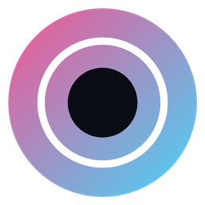
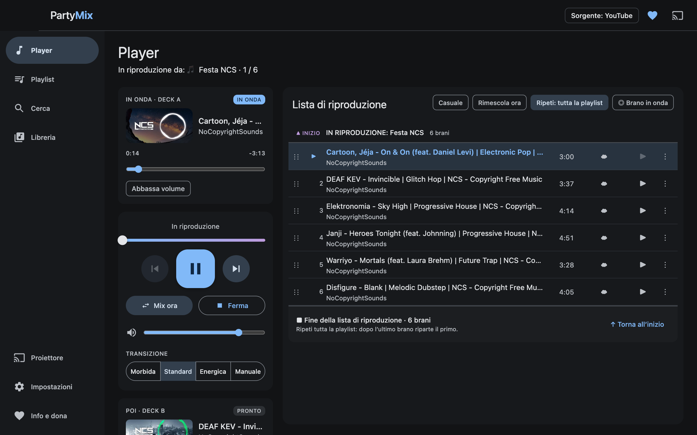
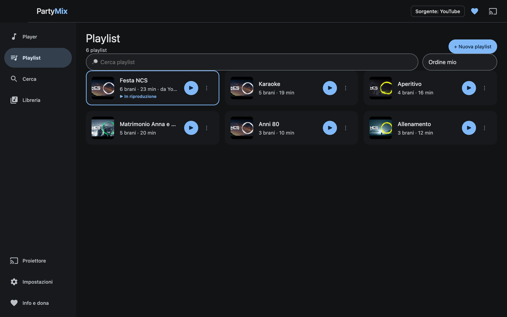
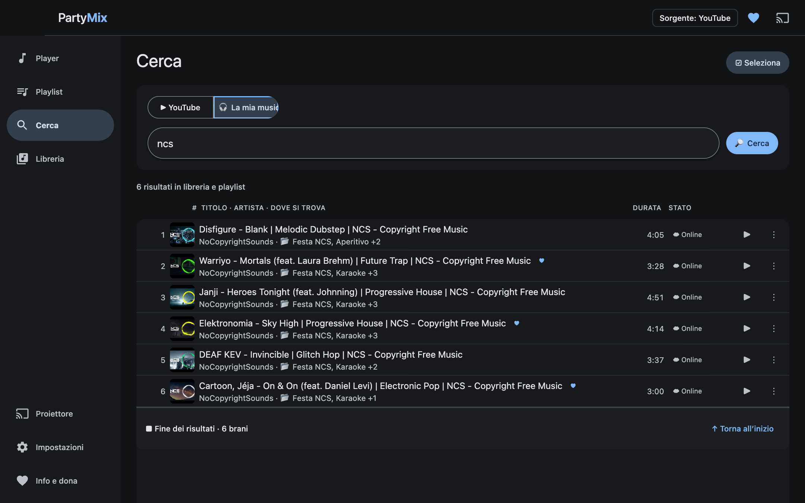
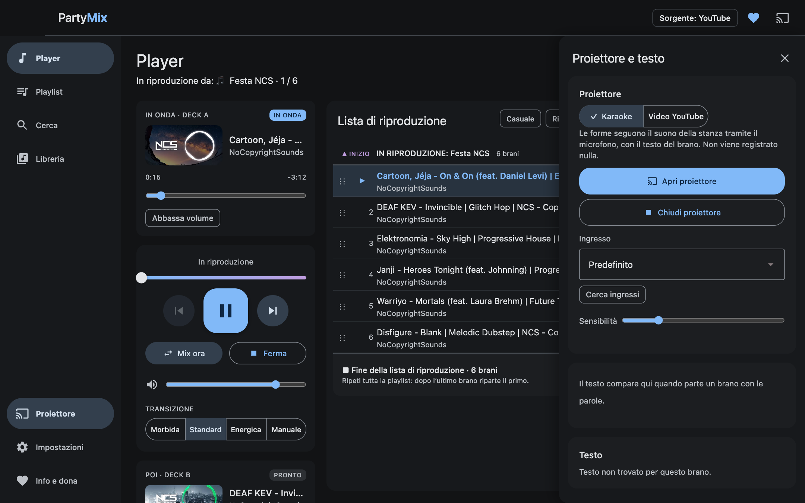
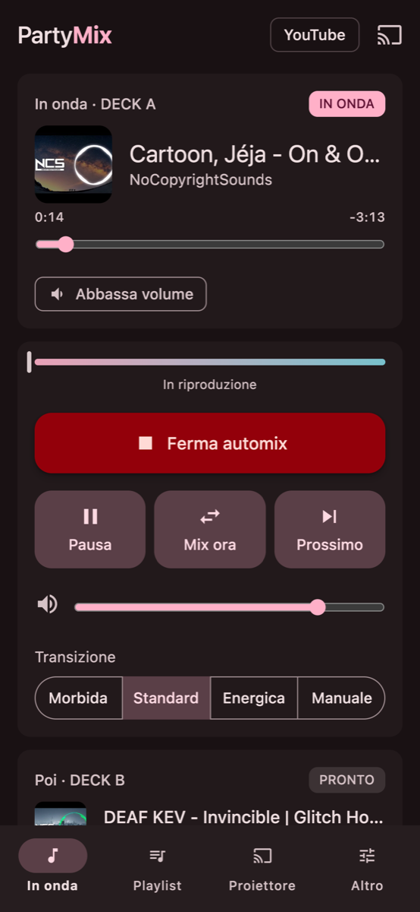
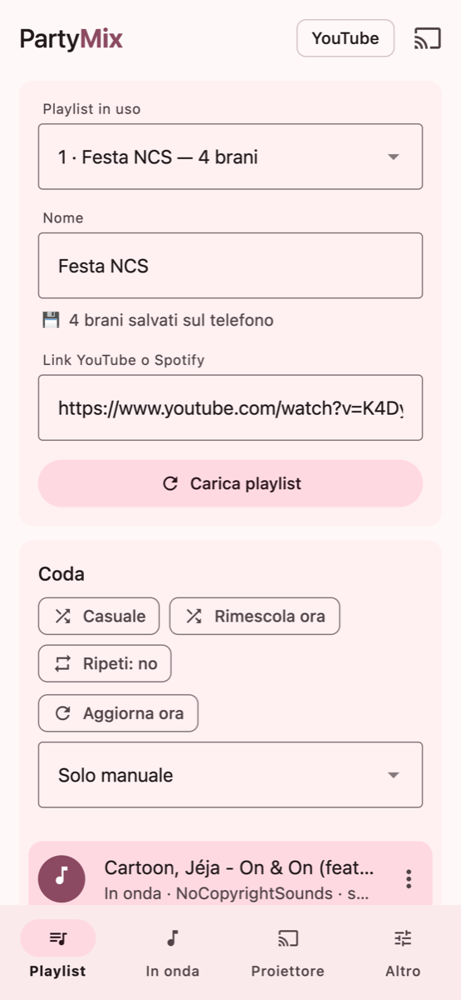
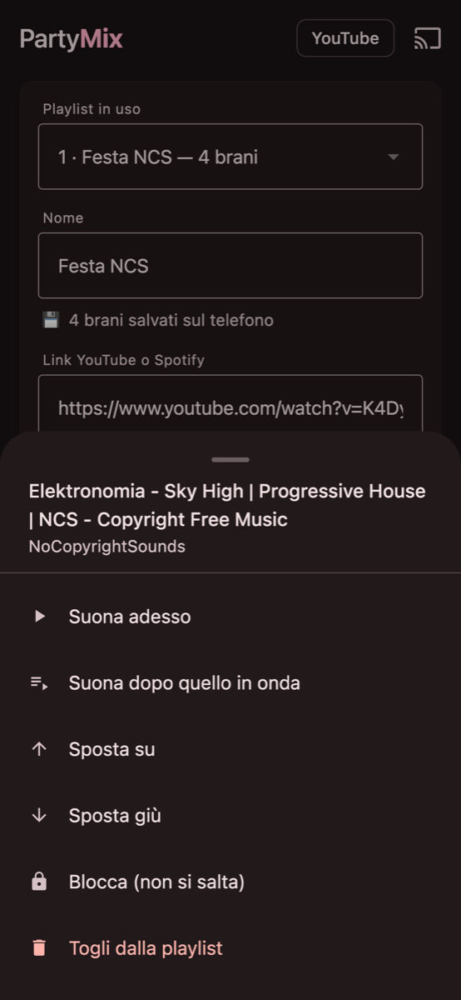
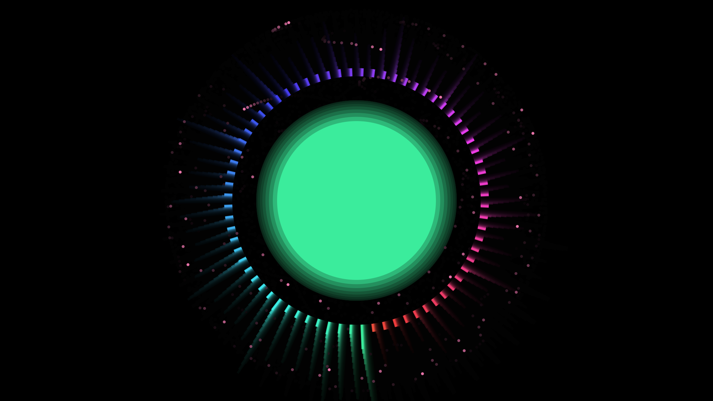
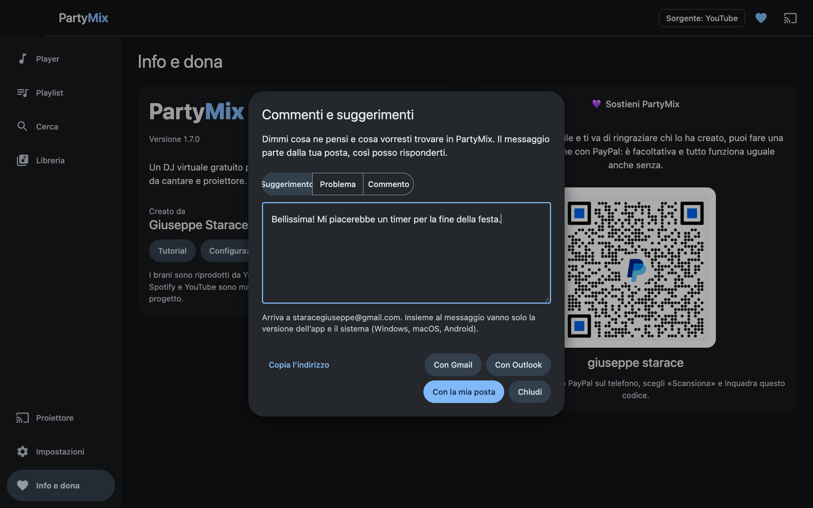

<p align="center">
  
</p>

<h1 align="center">PartyMix</h1>

<p align="center"><b>Il DJ virtuale gratuito per le tue feste.</b><br>
Incolli una playlist YouTube o Spotify, premi un tasto e la musica va avanti da sola, con le sfumature tra un brano e l'altro, i testi da cantare e il proiettore che balla con voi.</p>

<p align="center">
  <a href="https://github.com/staracegiuseppe/partymix/releases/latest"><b>⬇️ Scarica PartyMix</b></a> ·
  <a href="https://staracegiuseppe.github.io/partymix/">Sito</a> ·
  <a href="#commenti-e-suggerimenti">Commenti e suggerimenti</a>
</p>

<p align="center"></p>

<p align="center">  </p>

## Perché PartyMix

- **Mix automatico a due deck.** Mentre un brano suona, il successivo è già pronto sull'altro deck: il passaggio parte da solo con una sfumatura morbida, standard o energica. Mai un attimo di silenzio.
- **YouTube e Spotify.** Playlist YouTube, oppure playlist e album Spotify pubblici: PartyMix prende l'elenco e suona i brani da YouTube.
- **Tutte le playlist che vuoi, salvate sul dispositivo.** Nessun limite (prima erano quattro): crea, rinomina, duplica, elimina, cerca e ordina le playlist dalla barra laterale; si aprono all'istante anche senza rileggere YouTube. Togli i brani che non vuoi, cambia l'ordine: la lista resta così.
- **Libreria musicale locale (computer).** **+ Aggiungi musica locale**: importa MP3 (anche tanti insieme o un'intera cartella) che finiscono in *Musica › PartyMix Library/Artista/Brano.mp3*. Si suonano **anche senza rete**. Sezioni Tutte, Scaricate, Preferiti, Artisti, Album, Playlist; **🔎 Cerca nella libreria** trova un brano tra migliaia e ti dice in quali playlist e in quale cartella del PC si trova.
- **🔎 Cerca su YouTube (computer).** Scrivi titolo e/o artista: risultati con copertina, canale e durata; **▶ Riproduci**, **⤵ In coda**, **⏭ subito dopo**, **＋ Playlist**, **＋ Libreria**.
- **Nuova interfaccia per computer (Material Design 3).** Menu a sinistra con pagine separate: ▶ Player (deck, mixer e lista di riproduzione con «In riproduzione da: Festa · 3 / 124»), 📋 Playlist, 🔎 Cerca (risultati subito sotto il campo), ⬇ Download, 🎧 Libreria, ⚙ Impostazioni, 💜 Info e dona; 📺 Proiettore e testo si apre come pannello laterale sopra il Player. I colori seguono il colore di evidenziazione e il tema chiaro/scuro del computer. Le liste hanno un inizio e una fine ben visibili e restano fluide anche con 10.000 brani; il ritorno al primo brano è la funzione «Ripeti» del player. L'app per smartphone resta quella di sempre.
- **Karaoke automatico.** In sottofondo cerca i testi di tutta la playlist e li mostra a tempo, con le parole che si illuminano (o senza, se preferisci).
- **Proiettore.** Sul secondo schermo, a tutto schermo: forme che seguono la musica dal microfono con il testo da cantare, oppure il **video YouTube in grande** (perfetto per i balli tipo Just Dance), muto, allineato alla musica e senza pubblicità sullo schermo. Il video successivo viene precaricato: niente buchi neri tra un brano e l'altro.
- **Android in stile Material Design.** Sul telefono l'app è pensata per il tocco: quattro sezioni nella barra in basso (In onda, Playlist, Proiettore, Altro), i colori del tuo telefono (tema chiaro o scuro e Material You), le azioni su ogni brano in un pannello dal basso.
- **Android: proiettore in cast.** Dal telefono trasmetti a una TV o a un proiettore compatibile (schermo wireless) e lì compare il proiettore, mentre il telefono resta la console.
- **Pubblicità più sopportabili.** Può abbassare da solo il volume quando sente parlare come in uno spot e saltare le clip brevi.
- **Leggera e gratuita.** Circa 15 MB su Mac, nessun account: la musica arriva in streaming dai player ufficiali di YouTube, oppure dalla tua libreria sul computer.

<p align="center">  </p>

<p align="center"></p>

## Scarica

| Sistema | File | Come si installa |
|---|---|---|
| **macOS** (Apple Silicon) | `PartyMix_x.y.z_aarch64.dmg` | Apri il DMG e trascina PartyMix in Applicazioni. Primo avvio: clic destro → Apri. |
| **Windows 10/11** (64 bit) | `PartyMix_x.y.z_windows-x64.zip` | Estrai lo zip e apri `PartyMix.exe`, senza installare nulla. Se compare SmartScreen: *Ulteriori informazioni → Esegui comunque*. |
| **Linux** x86_64 (Fedora, Ubuntu 22.04 o successivo, Debian 12…) | `PartyMix_x.y.z_linux-x86_64.rpm` · `PartyMix_x.y.z_linux-amd64.deb` · `PartyMix_x.y.z_linux-x86_64.AppImage` | Fedora: `sudo dnf install ./PartyMix_*.rpm`. Ubuntu/Debian: `sudo apt install ./PartyMix_*.deb`. Oppure l'AppImage, senza installare: `chmod +x PartyMix_*.AppImage` e aprilo. |
| **Android** 7 o successivo | `PartyMix_x.y.z_android.apk` | Apri l'APK sul telefono e consenti l'installazione da questa fonte. |

Tutti i file sono nella pagina [**Release**](https://github.com/staracegiuseppe/partymix/releases/latest). Le app non sono firmate con un certificato a pagamento, quindi al primo avvio il sistema mostra un avviso: è normale, i dettagli sono in [docs/INSTALLAZIONE.md](docs/INSTALLAZIONE.md). Per aggiornare installa la nuova versione sopra la vecchia: impostazioni e playlist restano.

## Come si usa

📖 **La guida completa, con le schermate per computer e Android, è in [docs/GUIDA.md](docs/GUIDA.md).**

1. Incolla il link di una playlist YouTube o Spotify e premi **Carica playlist** (al primo avvio una configurazione guidata ti accompagna).
2. Dai un nome alla playlist, se vuoi: resta salvata sul PC insieme ai brani.
3. Premi **▶ Avvia automix**. Il resto lo fa PartyMix.
4. **Apri proiettore** e scegli cosa mostrare: *Karaoke* (forme e testo) o *Video YouTube*.

Doppio clic su un brano in coda per suonarlo subito, trascina la maniglia **⋮⋮** per cambiare ordine, **✕** per toglierlo dalla playlist. Il pulsante **Tutorial** in alto spiega ogni comando.

| Controllo | Cosa fa |
|---|---|
| Avvia / Ferma automix | Avvia; da avviato ferma tutto e riporta la coda all'inizio |
| Prossimo brano · Pausa · Transizione immediata | Passa al successivo (non salta un brano **bloccato**) · congela i deck · sfuma subito |
| Morbida / Standard / Energica / Manuale | Crossfade di 12 s / 8 s / 4 s / solo quando lo chiedi tu |
| Playlist (barra laterale) | Tutte le playlist, senza limite: clic per aprirla, ✎ rinomina, ⧉ duplica, 🗑 elimina, ricerca e ordinamento, trascina per riordinare o per aggiungere brani. **Carica playlist** la rilegge da YouTube o Spotify da capo. Sul telefono: menu a tendina |
| My Library | Tutte · Scaricate · Preferiti · Artisti · Album · Playlist, **🔎 Cerca nella libreria**, **+ Aggiungi musica locale** (file, cartella o link diretto a un MP3) |
| Coda | ⋮⋮ trascina o ↑/↓, 🔒 blocca, ✕ togli, ♥ preferito, ⬇ offline, **◎ Brano in onda**, **Casuale**, **Ripeti**, **Aggiorna ora**. Stato: ▶ in riproduzione · ⏸ pausa · ✓ offline · ☁ online · ⬇ download · ⚠ problema |
| Testo | Allineamento in due tocchi (① ②), anticipa/ritarda, velocità; **Parole che si illuminano** on/off |
| Proiettore | Karaoke o Video YouTube, schermo, ingresso audio, sensibilità |

Scorciatoie: `→` prossimo · `Spazio` pausa · `S` ferma · `M` transizione immediata · `↑`/`↓` volume.

## Commenti e suggerimenti

Ti piace? Manca qualcosa? Nell'app premi **💬 Commenti**: scrivi il messaggio, scegli se inviarlo con la tua posta, Gmail o Outlook, e parte dal tuo account. Così posso risponderti. Ogni idea è benvenuta.

<p align="center"></p>

## Sostieni il progetto

PartyMix è e resta gratuito, senza account e senza pubblicità aggiunte. Se ti ha fatto ballare e cantare, un piccolo contributo, del tutto facoltativo, aiuta a portare avanti nuove funzioni e aggiornamenti.

<p align="center"><br>Inquadra il codice con l'app PayPal, oppure <a href="https://www.paypal.com/qrcodes/p2pqrc/8AXGQ7233LRNL">tocca qui dal telefono</a>. Lo stesso codice è nella finestra <b>Info</b> dell'app.</p>

## Privacy

- Il microfono serve solo a far muovere le forme: l'audio è analizzato in tempo reale, **mai registrato né salvato**. Lo stesso vale per l'ascolto dell'audio del computer contro le pubblicità.
- Per i testi l'app invia titolo e artista a [LRCLIB](https://lrclib.net), [lyrics.ovh](https://lyrics.ovh) e Genius; per titoli e copertine usa l'oEmbed di YouTube. Nessun account, nessuna chiave, nessuna statistica.
- La libreria musicale resta sul computer (*Musica › PartyMix Library*); la ricerca nella libreria non manda niente in rete. «Cerca su YouTube» invia a Google quello che scrivi (con la tua chiave API, se l'hai inserita).
- I commenti partono solo quando li invii tu, dalla tua posta.

Dettagli: [informativa sulla privacy](https://staracegiuseppe.github.io/partymix/privacy.html).

## Note legali

I brani sono riprodotti dai player ufficiali di YouTube; con Spotify l'app usa solo l'elenco dei brani. YouTube e Spotify sono marchi dei rispettivi proprietari, estranei a questo progetto. I testi appartengono ai rispettivi autori: mostrarli o suonare musica in un evento pubblico può richiedere licenze, verifica cosa serve per la tua festa.

Cosa YouTube permette e cosa no (BPM, beatmatching, EQ…) è spiegato in [docs/LIMITI-YOUTUBE.md](docs/LIMITI-YOUTUBE.md).

Il codice di PartyMix è distribuito con [licenza MIT](LICENSE): puoi usarlo, modificarlo e ridistribuirlo liberamente, mantenendo l'avviso di copyright.

## Sviluppo

App [Tauri 2](https://tauri.app) (Rust + TypeScript, Vite), un unico codice per macOS, Windows, Linux e Android.

```bash
npm install
npm test                # test della logica, dell'automix, dei testi e della UI
npx tauri dev           # avvia l'app
npx tauri build         # pacchetto per il sistema in uso
npx tauri android build --apk --target aarch64
npx tauri build --bundles appimage,deb,rpm   # su Linux
```

**Linux.** Servono le librerie di sviluppo di WebKitGTK e ALSA (Fedora: `sudo dnf install webkit2gtk4.1-devel gtk3-devel libsoup3-devel alsa-lib-devel dbus-devel librsvg2-devel libxdo-devel gcc pkgconf-pkg-config`; Ubuntu/Debian: `sudo apt install libwebkit2gtk-4.1-dev libgtk-3-dev libsoup-3.0-dev libjavascriptcoregtk-4.1-dev libdbus-1-dev libasound2-dev librsvg2-dev libxdo-dev build-essential pkg-config file patchelf`). Per avere i video di YouTube anche in sviluppo installa i plugin di GStreamer: `gstreamer1.0-plugins-good gstreamer1.0-plugins-bad gstreamer1.0-libav`. Il workflow [`.github/workflows/linux.yml`](.github/workflows/linux.yml) (avvio manuale da *Actions → Linux → Run workflow*) produce AppImage, .deb e .rpm (Fedora) su Ubuntu 22.04 e, se gli indichi una release, li allega lì.

Struttura: `src-tauri/src/download/` (Download Manager in Rust: `validate.rs`, `downloader.rs` con yt-dlp, `metadata.rs`, `queue.rs`, comandi `dl_*` al posto delle rotte REST), `src/download/` (client e collegamento a libreria e playlist), `src/ui/downloadsUI.ts`, `src/automix.ts` (motore), `src/audioDeck.ts` (deck audio locale + deck ibrido locale/YouTube), `src/library/` (playlist dinamiche, libreria, IndexedDB, tag ID3), `src/ui/virtualList.ts` (lista virtuale circolare), `src/ui/libraryUI.ts` (barra laterale e viste della libreria), `src/queue.ts`, `src/crossfade.ts`, `src/youtubeDeck.ts`, `src/lyrics.ts`, `src/savedPlaylists.ts`, `src/projector/` (proiettore, video e precaricamento), `src/ui/` (console), `src-tauri/` (Rust: finestre, schermi, cattura audio), `src-tauri/gen/android/` (app Android, proiettore in cast in `CastProjector.kt`).

Se la cartella del progetto è in iCloud, tieni `node_modules` e la cartella `target` di Cargo fuori da iCloud (`CARGO_TARGET_DIR`), altrimenti i file vengono "svuotati" e gli strumenti si bloccano.

## Libreria musicale, offline e ricerca (computer)

- **Import.** «+ Aggiungi musica locale» accetta MP3 (anche M4A, OGG, FLAC, WAV): un file, tanti file o una cartella intera, oppure trascinandoli sulla barra laterale. Ogni file viene controllato (un file non audio, vuoto o danneggiato viene scartato con il motivo), i duplicati non si importano due volte, titolo/artista/album/copertina vengono dai tag ID3 o dal nome del file.
- **Offline.** I brani della libreria (✓) suonano senza rete. Se la rete manca, PartyMix salta i brani solo online (☁) senza segnarli come rotti e senza riprovarli di continuo; quando la rete torna li suona di nuovo. **Elimina download** toglie solo il file: il brano resta nelle playlist.
- **⬇ Download Manager (computer).** Incolla l'indirizzo di un contenuto che hai il diritto di scaricare: il download parte in sottofondo con [yt-dlp](https://github.com/yt-dlp/yt-dlp) installato sul computer (`brew install yt-dlp ffmpeg`), al massimo 2 alla volta (configurabile). Audio MP3/M4A/Opus/originale, video MP4/WebM. Pagina con In corso / In coda / Completati / Errori, barra, velocità, ETA, annulla e riprova; a fine download il brano è nella Libreria (offline) e, se scelta, nella playlist. Un contenuto già scaricato non viene riscaricato. File in *Musica › PartyMix Library*; i download interrotti ripartono da soli. Solo indirizzi web pubblici. Nessun aggiramento di DRM, abbonamenti o restrizioni di accesso.
- **Ricerca su YouTube.** Con una chiave gratuita di «YouTube Data API v3» (da inserire nella vista di ricerca) usa le API ufficiali: durata, video non riproducibili segnalati, e playlist lette per intero anche oltre 200 brani. Senza chiave legge la pagina dei risultati, come già fa per Spotify. Ogni ricerca con chiave consuma 100 unità della quota gratuita giornaliera (10.000, cioè circa 100 ricerche al giorno); le ricerche ripetute entro 10 minuti non consumano quota.
- **Limiti tecnici.** Nessun limite fisso a playlist, brani, file o coda. La lista circolare usa al massimo 8 milioni di pixel virtuali: oltre circa 200.000 brani in una sola playlist il giro continuo diventa meno frequente da ricentrare ma resta corretto. Senza chiave API YouTube il player legge al massimo circa 200 brani di una playlist (limite di YouTube).

## Playlist Spotify

Nel campo del link si possono incollare anche playlist e album **Spotify pubblici**. Spotify non si può riprodurre dentro l'app (è protetto): PartyMix legge l'elenco dei brani dalla pagina di incorporamento pubblica di Spotify, cerca ogni brano su YouTube (preferendo l'audio dello studio, per avere i testi sincronizzati) e lo suona da lì. Limiti: Spotify mostra solo i primi brani della lista (50 nelle playlist di prova), alcuni brani possono non trovarsi su YouTube (l'app lo dice), e una playlist Spotify viene letta una volta sola (nessun aggiornamento automatico). Funziona solo nell'app installata, non da browser.

## Karaoke automatico

Dopo aver caricato una playlist, in sottofondo PartyMix cerca i testi di tutti i brani (LRCLIB con i tempi, poi LRCLIB testo semplice, lyrics.ovh e Genius) e li tiene salvati: ogni brano si cerca una volta sola e il testo è già pronto quando parte. In coda ogni brano ha un'etichetta: «testo a tempo» (tempi esatti), «testo stimato» (testo trovato, tempi calcolati sulla durata) o «senza testo». Il pannello «Karaoke automatico» mostra l'avanzamento; le fonti gratuite chiedono di non essere sommerse, quindi la ricerca va piano (circa un brano ogni 2-4 secondi) e aspetta se un servizio è occupato. Per i brani con «testo stimato» (tipicamente in dialetto o poco noti) i tasti ① e ② della barra in basso allineano il testo in due tocchi, e l'allineamento resta salvato.

## Pubblicità: abbassare il volume da solo

Dal pannello «Pubblicità» si può attivare l'ascolto dell'**audio che sta suonando sul computer** (non il microfono). PartyMix ne misura ogni 100 ms alcune caratteristiche (energia nelle fasce di frequenza, pause, quanto è «tonale») e capisce se somiglia a una voce che parla, come in uno spot, oppure a una canzone. Se sente parlato per qualche secondo abbassa il volume del deck in onda al 20%, e lo rialza quando torna la musica. Il pulsante «Abbassa volume» manuale continua a funzionare. L'audio non viene registrato né salvato: restano solo i numeri dell'analisi.

- Funziona nell'app installata, su **macOS 14.6 o successivo** (la prima volta il Mac chiede il permesso di registrare l'audio di sistema) e su **Windows 10/11** (non provato su Windows). Su **Linux** l'ascolto parte dal dispositivo di registrazione predefinito: per fargli sentire la musica e non il microfono, con PulseAudio o PipeWire apri `pavucontrol` → *Registrazione* e per PartyMix (compare come «ALSA plug-in [partymix-ai]») scegli «Monitor di …» la tua uscita audio (non ancora provato su Linux).
- Tarato su voci di sintesi italiane e inglesi e su 16 brani veri (rap e pop): 14 voci su 14 riconosciute dopo 5-9 secondi, 0 brani su 16 scambiati per parlato. Provato dal vivo sulla playlist «birra» (circa 35 brani di pop italiano e karaoke, 13 secondi ciascuno): all'inizio erano scattati due falsi allarmi (l'intro quasi a cappella di «A far l'amore comincia tu» e 2 secondi tra due brani), risolti chiedendo che la voce domini il suono (energia sotto i 500 Hz) e che faccia pause da parlato; dopo la correzione nessun falso allarme. Il pannello mostra lo storico degli ultimi rilevamenti, con brano e valori misurati, per capire dove scatta. Una pubblicità con la **musica sotto la voce** non viene riconosciuta, e una voce registrata molto «brillante» potrebbe sfuggire: per questo c'è la sensibilità (Alta/Normale/Prudente).
- **Brani brevi (spot).** Gli spot nelle playlist sono clip da pochi secondi a un minuto, le canzoni durano minuti. Dal pannello si può scegliere «Brani brevi (spot)»: «Abbassa il volume» o «Salta al brano dopo» per i brani sotto i **75 secondi** (di serie «Non fare niente»). Funziona anche senza ascoltare l'audio, quindi prende anche gli spot fatti solo di musica. Non si applica alle pubblicità inserite da YouTube nel suo player, che non vengono né saltate né nascoste.
- Provato su 30 spot veri registrati dall'audio di sistema contro 13 canzoni vere con la stessa catena: le caratteristiche del suono da sole non bastano per separare uno spot di sola musica da una canzone (a validazione per clip, il 36% degli spot per l'8% di canzoni scambiate), per questo la durata è il segnale principale per quel caso.
- Codice: `src-tauri/src/capture.rs` (cattura nativa con `cpal`), `src/audioAnalysis.ts` (caratteristiche), `src/adDetector.ts` (decisione), `src/adGuard.ts` (controllo).
