

<h1 align="center">Guida di PartyMix</h1>

<b>Il DJ virtuale gratuito per le tue feste.</b> Incolli una playlist, premi un tasto e la musica va avanti da sola: sfumature tra i brani, karaoke e proiettore sulla TV.

  <a href="https://github.com/staracegiuseppe/partymix/releases/latest"><b>⬇️ Scarica PartyMix</b></a> ·
  <a href="https://staracegiuseppe.github.io/partymix/">🌐 Sito</a> ·
  <a href="#-sostieni-partymix">💜 Sostieni il progetto</a>

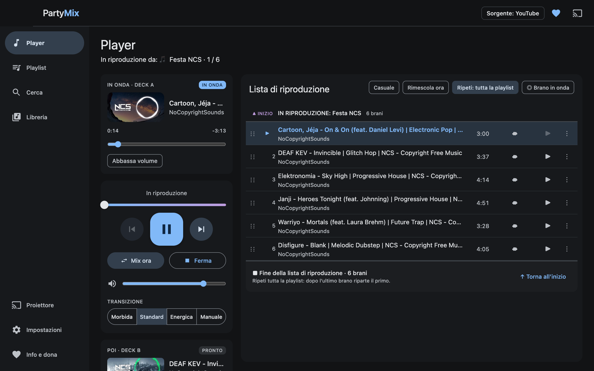

  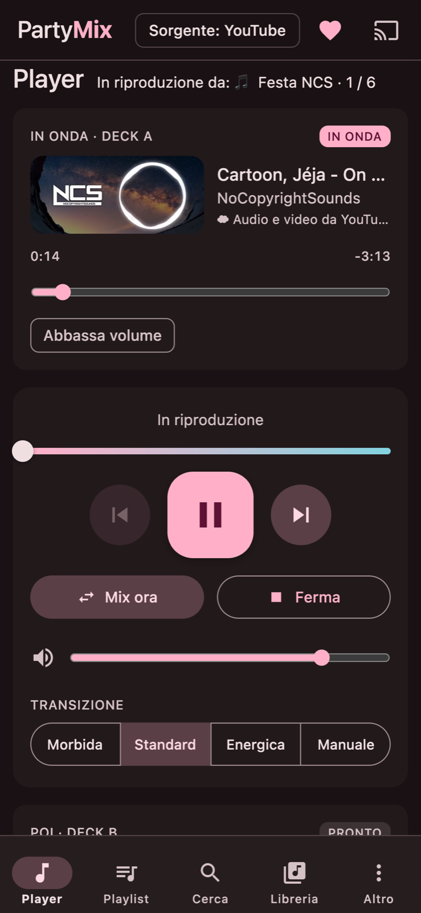
  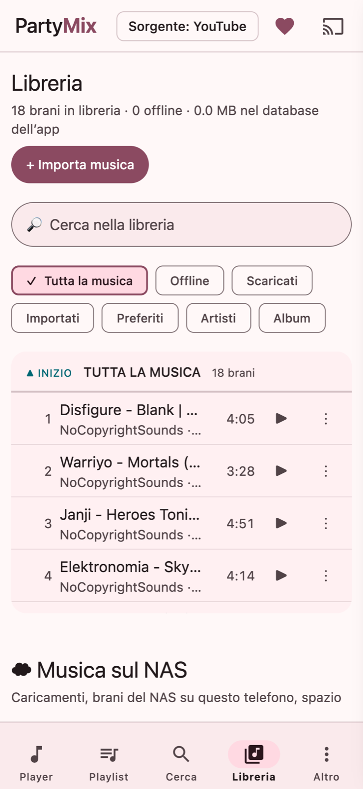
  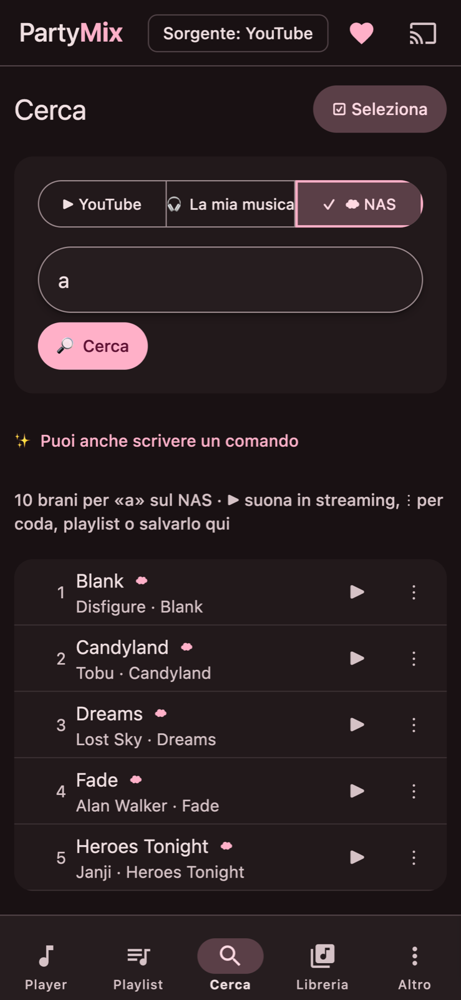

PartyMix suona una playlist YouTube o Spotify come farebbe un DJ: mentre un brano finisce, il successivo entra con una sfumatura. Puoi mandare su una TV o un proiettore le forme che ballano a tempo con il testo da cantare, oppure il video del brano.

Questa guida vale per 💻 **computer** (macOS, Windows e Linux) e 📱 **Android**. Dove cambia qualcosa, lo trovi indicato. Per scaricare e installare l'app leggi [INSTALLAZIONE.md](INSTALLAZIONE.md).

- [1. Primo avvio](#1-primo-avvio)
- [2. Dove si trova cosa](#2-dove-si-trova-cosa)
- [3. Le playlist](#3-le-playlist)
- [4. Far partire la musica](#4-far-partire-la-musica)
- [5. La coda dei brani](#5-la-coda-dei-brani)
- [6. Il proiettore](#6-il-proiettore)
- [7. Il testo da cantare](#7-il-testo-da-cantare)
- [8. Pubblicità e spot](#8-pubblicità-e-spot)
- [9. Commenti, aiuto e informazioni](#9-commenti-aiuto-e-informazioni)
- [10. Se qualcosa non va](#10-se-qualcosa-non-va)
- [11. Il NAS di casa](#11-il-nas-di-casa)
- [💜 Sostieni PartyMix](#-sostieni-partymix)

## 1. Primo avvio

Al primo avvio si apre la **Configurazione guidata**, che ti fa fare tutto in ordine: caricare una playlist, aprire il proiettore, scegliere il microfono e lo stile delle transizioni. Puoi riaprirla quando vuoi:

- **Computer:** pulsante «Configurazione guidata» in alto.
- **Android:** **⋮ Altro › Impostazioni › Aiuto**.

Il **Tutorial** mostra una parte dell'app alla volta con una breve spiegazione. Su Android ti porta da solo nella sezione di cui parla.

## 2. Dove si trova cosa

### Computer

L'app è divisa in pagine (su Android sono le stesse, vedi sotto), come una vera app musicale. Il **menu a sinistra** (su finestre strette diventa una colonna di icone) porta a:

- **▶ Player** — quello che suona: i due deck (A e B) con il mixer, i comandi ⏮ ⏸ ⏭, e la **lista di riproduzione**. In alto leggi da dove arriva la musica: *In riproduzione da: 🎵 Festa · 3 / 124*.
- **📋 Playlist** — tutte le tue playlist; aprine una per vederne i brani e gestirla.
- **🔎 Cerca** — cerca una canzone su YouTube, nella tua musica o sul ☁ NAS: i risultati compaiono subito sotto il campo.
- **⬇ Download** — i download in corso, in coda, completati e con errori.
- **🎧 Libreria** — la tua musica sul computer: importati, scaricati, preferiti, artisti, album. In fondo «☁ Musica sul NAS» con i caricamenti, brano per brano.
- In fondo: **📺 Proiettore** (si apre come pannello a destra sopra il Player: proiettore e testo da cantare, senza lasciare la musica), **⚙ Impostazioni** (karaoke, pubblicità, aggiornamento playlist, chiave YouTube, aiuto e, in fondo, il collegamento al NAS e i dispositivi) e **💜 Info e dona** (crediti e donazione facoltativa con PayPal, anche dal ♥ in alto).
- I colori seguono il computer: il colore di evidenziazione scelto nelle impostazioni di sistema (Mac, Windows, Linux GNOME) e il tema chiaro o scuro.

Ogni brano ha il menu **⋮** (o clic destro) con le azioni che ha senso fare in quel momento: suona adesso, suona dopo, metti in coda, aggiungi a playlist, scarica, preferiti, togli.

### Android

Su Android ci sono **le stesse pagine del computer**: Player, Playlist, Cerca e Libreria. Le trovi nella **barra in basso**. La quinta voce, **⋮ Altro**, apre un pannello con Proiettore e testo, Impostazioni (dove ci sono anche il NAS e i dispositivi), Info e dona e **Scegli dalle app**.

<table>
<tr>
<td align="center"> <b>Player</b></td>
<td align="center">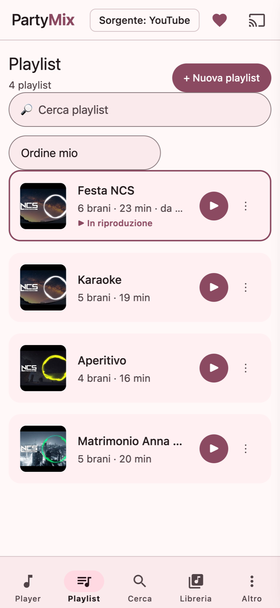 <b>Playlist</b> (tema chiaro)</td>
<td align="center"> <b>Cerca</b> (☁ NAS)</td>
<td align="center">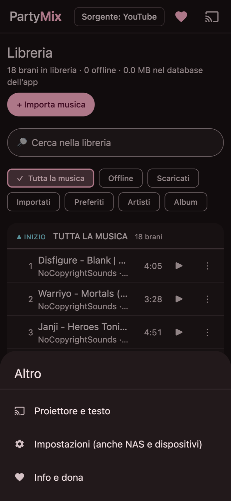 <b>⋮ Altro</b></td>
</tr>
</table>

- L'icona **Trasmetti** in alto a destra apre subito il proiettore sulla TV.
- Il tasto **Indietro** chiude un pannello aperto, poi torna al Player. Dal Player manda l'app in secondo piano senza chiuderla, quindi la musica continua.
- I messaggi dell'app compaiono in basso per qualche secondo; toccali per farli sparire.
- I **colori seguono il tuo telefono**: tema chiaro o scuro come l'hai impostato. Da Android 12 l'app usa anche i colori Material You presi dallo sfondo.
- Su un telefono non c'è la pagina Download: per avere un brano anche senza rete lo salvi dal NAS (vedi [11. Il NAS di casa](#11-il-nas-di-casa)).

## 3. Le playlist

Puoi tenere **tutte le playlist che vuoi**: non c'è più il limite di quattro. Le playlist che avevi già passano da sole nel nuovo elenco, con i loro nomi e brani.

**Computer:** apri la pagina **📋 Playlist**.

 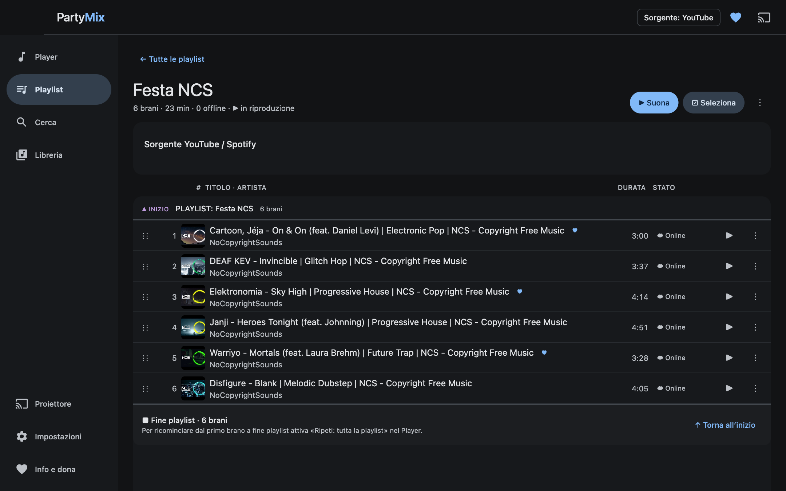

- Ogni playlist è una scheda con nome, numero di brani e durata; quella che sta suonando ha il bordo colorato e «▶ In riproduzione».
- **▶** sulla scheda la suona subito; un clic sulla scheda la apre.
- **+ Nuova playlist**, **Cerca playlist** e il menu per ordinarle: «Ordine mio» (trascinando le schede), per nome, modificate di recente, più brani.
- **⋮** su una scheda: Suona, Apri, Rinomina, Duplica, Elimina (chiede conferma; i brani della libreria restano).
- Dentro una playlist: in cima «▲ Inizio · PLAYLIST: nome», poi i brani numerati (#, titolo, artista, durata, stato), in fondo «■ Fine playlist». Trascina la maniglia **⋮⋮** per cambiare ordine; **⋮** su un brano per toglierlo o aggiungerlo a un'altra playlist.
- **Sorgente YouTube / Spotify**: incolla il link e premi **Carica** per riempire la playlist da lì.
- **🔄 Aggiorna da YouTube** (solo per le playlist YouTube): se hai cambiato la playlist su YouTube, aggiunge in fondo i brani nuovi e toglie quelli che hai cancellato là. Il tuo ordine e le tue sostituzioni restano; il brano in onda non viene mai tolto. «Carica», invece, la rilegge da capo.
- **⬇ Scarica tutta la playlist**: scarica in un colpo tutti i brani (quelli già nella libreria vengono saltati), per crearti subito la tua discografia sul computer.
- **☑ Seleziona**: tocca i brani che vuoi (Maiuscolo+clic per un intervallo), oppure **Seleziona tutti**, poi **⬇ Scarica selezionati** o **＋ Aggiungi a playlist**. **✕ Fine** chiude la selezione. C'è anche nella pagina Cerca.
- Prima di ogni download l'app chiede il formato: **🎵 Audio MP3** (solo musica, file piccoli) oppure **🎬 Video MP4** (con le immagini: è quello giusto per le versioni *lyrics* e karaoke, dove il testo è nel video), anche in 720p più leggero. L'ultima scelta viene proposta per prima.
- Una playlist contiene solo riferimenti ai brani: lo stesso brano in più playlist non occupa spazio due volte.

**Android:** la stessa pagina Playlist del computer. **iPhone:** scegli la playlist dal **menu a tendina**, che mostra il nome e quanti brani ha salvato, oppure «vuota».

**Aggiungere una playlist da YouTube o Spotify**

1. Crea una playlist nuova (o scegline una vuota).
2. Dalle un nome, per esempio «Festa», «Karaoke» o «Just Dance».
3. Incolla il link di una playlist YouTube, oppure di una playlist o di un album Spotify pubblici, e premi **Carica playlist**.

Su Android c'è un modo più comodo: **⋮ Altro › Scegli dalle app**.
1. Apri la playlist in YouTube o in Spotify.
2. Tocca **Condividi › PartyMix**: la playlist si carica da sola.

**Salvataggio.** I brani restano salvati sul computer o sul telefono.
- Quando torni a quella playlist si apre subito, senza aspettare YouTube.
- I brani che togli restano tolti e l'ordine che scegli resta com'è.
- **Carica playlist** rilegge invece la playlist da YouTube o Spotify da capo.

**Aggiornamento.** Se aggiungi brani alla playlist su YouTube, PartyMix li può prendere da solo: nella coda scegli ogni quanti minuti controllare, oppure premi «Aggiorna ora». Una playlist Spotify viene letta una volta sola.

Con Spotify l'app prende solo l'elenco dei brani e li suona da YouTube, perché Spotify non si può suonare dentro altre app. Qualche brano può non trovarsi: l'app ti dice quali.

## 4. Far partire la musica

Premi **Avvia automix**. Parte il primo brano e da lì l'app va avanti da sola: un deck suona e l'altro prepara il brano dopo, così non c'è mai silenzio.

| Comando | Cosa fa |
|---|---|
| **Pausa / Riprendi** | Ferma e fa ripartire tutto |
| **Mix ora** (computer: «Transizione immediata») | Sfuma subito nel brano già pronto |
| **Prossimo** | Salta al brano successivo, con una sfumatura |
| **Volume** | Volume di tutta la festa |
| **Transizione** | Morbida (circa 12 secondi), Standard (8), Energica (4) o Manuale (il cambio avviene solo quando lo chiedi tu) |
| **Abbassa volume** | Abbassa al volo il brano in onda, per esempio durante un annuncio; si ripremi per tornare normale |

Sul computer funzionano anche i tasti rapidi:
- Spazio: pausa.
- → (freccia destra): prossimo.
- M: mix ora.
- S: ferma l'automix.
- ↑ e ↓ (frecce su e giù): volume.

## 5. La coda dei brani

**Computer.** La lista di riproduzione, nella pagina Player, ha un inizio e una fine ben visibili: in cima «▲ Inizio · IN RIPRODUZIONE: nome · N brani», in fondo «■ Fine della lista di riproduzione · N brani» con **↑ Torna all'inizio**. Va bene anche con migliaia di brani.
- Scorri con la rotella o il trackpad, oppure **tieni premuto e trascina** la lista con il mouse (lasciando, continua a scorrere e rallenta, e si ferma all'inizio o alla fine). Su uno schermo touch, con il dito.
- Ogni riga mostra: il numero (o ▶ in riproduzione / ⏸ in pausa), titolo e artista, la durata e lo stato con icona e parola: ✓ Offline · ☁ Online · ⬇ Download · ⏳ In coda · ⚠ Errore.
- **▶** suona subito il brano (anche doppio clic o Invio); **⋮** apre il menu: suona dopo quello in onda, sposta su/giù, aggiungi a playlist, scarica, preferiti, blocca, togli. Per cambiare l'ordine trascina la maniglia **⋮⋮**.
- Dopo l'ultimo brano la musica si ferma, a meno che tu non scelga **Ripeti: tutta la playlist** (oppure **Ripeti: questo brano**): il ritorno al primo brano è una scelta del player, scritta anche in fondo alla lista.
- **◎ Brano in onda** riporta in vista il brano che suona. La lista non salta mai da sola: resta dov'eri anche quando cambia brano, e ogni playlist ricorda il suo punto.

**Android.** La stessa lista del computer: tocca **▶** per suonare un brano, **⋮** per il menu (si apre dal basso), e trascina la maniglia **⋮⋮** per cambiare ordine. **Un tocco sulla riga** la seleziona e, se il titolo è più lungo della riga, lo fa scorrere per leggerlo tutto; **un secondo tocco** sulla stessa riga apre il menu del brano.

### Start ed End del brano (tagli da DJ)

Mentre un brano suona, sotto i tasti del player ci sono **⏱ SET START** e **⏱ SET END**:
- **SET START** (tasto **S** sul computer): da adesso il brano parte da qui. Prende la posizione del player nell'istante in cui premi, al millesimo (es. 00:37.420). Premerlo di nuovo sostituisce il valore.
- **SET END** (tasto **E**): il brano finisce qui e parte il successivo (con la sfumatura scelta, anche in «Manuale»). L'End deve venire dopo lo Start, altrimenti compare un avviso e non viene salvato.
- **🎧 DJ Edit** mostra posizione attuale, Start, End, durata originale/effettiva/tolta, **▶ Preview** (torna allo Start) e **↺ Reset** (il brano torna originale).
- Il file **non viene mai tagliato**: sono solo due numeri legati al brano. Nella lista compare «✂ 00:42.317 → 03:48.650».
- **Nessun tasto Salva:** tutto si salva da solo, subito. Con il NAS collegato i tagli vanno sul NAS **solo per il tuo utente** (gli altri utenti del NAS non li vedono) e arrivano sugli altri tuoi dispositivi; se il NAS non è raggiungibile restano in attesa e partono appena torna.
- Se trascini la barra del player oltre l'End, l'End viene ignorato per quell'ascolto: puoi sempre andare avanti e indietro nel brano.
- Sul computer **Ferma** ora è **Maiusc+S** (la S da sola è SET START).

**Comandi comuni**
- **Casuale**, **Rimescola ora** e **Ripeti** (no, tutta la playlist, solo questo brano).
- Puoi aggiungere un singolo video incollando il suo link.
- Il brano in onda non si può togliere: passa al successivo e poi toglilo.
- Se un brano non si può riprodurre, compare un avviso. Lì incolli il link di un brano sostitutivo e l'app ti dice subito se va bene.

## 5b. Libreria, ricerca e download

**Aggiungere la tua musica.** Nella pagina **🎧 Libreria** premi **+ Importa musica** → «Scegli file» (anche tanti insieme) o «Scegli una cartella». Puoi anche trascinare i file nella pagina. Non c'è un limite al numero di file; alla fine leggi per esempio «✓ Importati 25 brani».
- I file vanno nella cartella *Musica › PartyMix Library*, divisi per artista.
- Titolo, artista, album e copertina vengono dal file; se mancano, dal nome del file.
- Un file non audio, vuoto o danneggiato viene scartato e l'app ti dice perché. Lo stesso brano non viene importato due volte.

**Senza rete.** I brani ✓ della libreria suonano anche senza internet. Se la rete manca compare l'avviso 📴: PartyMix suona i brani ✓ e salta quelli ☁ (solo online), senza riprovarli di continuo. Quando la rete torna, li suona di nuovo.

**⬇ Download (solo computer).** Nella pagina **⬇ Download** incolla l'indirizzo di un contenuto che hai il diritto di scaricare (o premi **⬇** / «Scarica» nel menu ⋮ di un brano).
- Scegli **Audio** (MP3, M4A, Opus o Originale) o **Video** (MP4 o WebM, qualità Best, 1080p, 720p, 480p, 360p: se una qualità non esiste si prende la più vicina) e, se vuoi, la **playlist** in cui metterlo.
- La pagina divide i download in **In corso**, **In coda**, **Completati** ed **Errori**. Ogni download ha la sua barra con percentuale, velocità, tempo che manca e MB scaricati, e **Annulla**. Ne partono al massimo 2 alla volta (puoi cambiarlo).
- Finito: **▶ Play**, **＋ Playlist**, **📚 Apri libreria**. Il brano è già nella Libreria e suona senza rete.
- Un brano già scaricato non viene scaricato di nuovo («✓ Già scaricato»). Se un download non riesce, l'app dice perché (rete, contenuto non disponibile, spazio, formato…) e c'è **↻ Riprova**. Se chiudi l'app durante un download, alla riapertura riparte da solo.
- Serve il programma gratuito **yt-dlp** (e **FFmpeg** per MP3/M4A/Opus e per i video): sul Mac `brew install yt-dlp ffmpeg`, su Windows `winget install yt-dlp` e `winget install ffmpeg`. Se manca, o se è troppo vecchio, la pagina te lo dice con il comando per aggiornarlo.
- Scarica solo contenuti che hai il diritto di scaricare. PartyMix non aggira protezioni (DRM) né abbonamenti.

**Usare un tuo file.** Senza yt-dlp, «Rendi offline con un tuo file…» nel menu ⋮ ti fa scegliere un tuo file audio di quel brano. «Elimina download» toglie solo il file: il brano resta nelle playlist.

 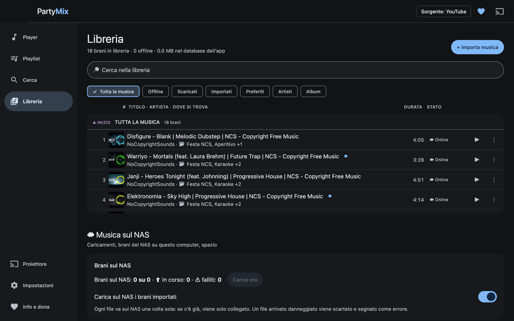

**🔎 Cerca.** Nella pagina **🔎 Cerca** scegli dove cercare, **▶ YouTube**, **🎧 La mia musica** o **☁ NAS** (quando il NAS è collegato, vedi il capitolo 11), scrivi titolo, artista o tutti e due (per esempio «The Weeknd Blinding Lights») e premi Invio: i risultati compaiono subito sotto il campo, senza cambiare pagina.
- Con **La mia musica** l'app cerca tra tutti i brani della libreria e di tutte le playlist (anche per nome della playlist), anche senza rete. Ogni risultato mostra, solo come informazione, **in quali playlist** si trova (📂) e **dove è il file sul PC** (💾).
- Su YouTube vedi copertina, titolo, canale e durata; i video che non si possono riprodurre sono segnalati con il motivo.
- Su ogni risultato: **▶** lo suona subito; **⋮** → suona dopo quello in onda, metti in coda (in fondo), aggiungi a playlist (una finestra con le tue playlist e «Nuova playlist»), preferiti.
- Messo in coda così, il brano entra nella lista di riproduzione ma non cambia la playlist salvata (per salvarlo usa «Aggiungi a playlist»).
- Per risultati migliori inserisci una chiave gratuita di «YouTube Data API v3» in **⚙ Impostazioni → Ricerca YouTube**.

**✨ Comandi in italiano.** Nello stesso campo puoi scrivere cosa vuoi con parole semplici, per esempio:
- «i video di Just Dance più visti degli ultimi anni, ballabili, aggiungili alla mia playlist»
- «metti in coda 10 canzoni anni 80 da cantare»
- «crea la playlist Matrimonio con 20 canzoni d’amore italiane più famose»
- «aggiungi 15 successi di Max Pezzali con testo a Karaoke»
- «suona Vasco Rossi Albachiara» · «subito dopo Gloria Gaynor I Will Survive» · «cerca nella mia musica Jovanotti»

L'app riconosce **cosa fare** (aggiungi a…, metti in coda, subito dopo, suona, crea la playlist…), **quanti** brani (10, venti…), **quali** (più visti / più famosi, più votati, recenti, degli ultimi anni, di quest’anno, ballabili, karaoke / da cantare, con testo, ufficiali, anni 80…) e **cosa cercare** (il resto). Ti mostra **✨ Ho capito** con quello che ha capito e la proposta di brani già spuntati: togli quelli che non vuoi e premi **✓**. Niente viene aggiunto prima della conferma; «suona» e «subito dopo» partono subito con il primo risultato. Funziona tutto sul computer, senza intelligenza artificiale a pagamento: l'elenco delle parole che capisce è sotto **✨ Puoi anche scrivere un comando**.

## 6. Il proiettore

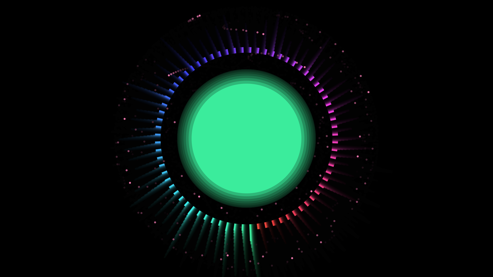

Il proiettore è una seconda schermata, da mandare su TV o videoproiettore, che mostra una di due cose:

- **Karaoke:** forme colorate che seguono il suono della stanza attraverso il **🎤 microfono** (quello del computer o uno collegato, da scegliere in Proiettore → 🎤 Microfono), con il testo da cantare. Il suono non viene registrato. I brani che hai sul computer suonano dal tuo file.
- **Video YouTube:** il video del brano in onda a tutto schermo, muto e allineato alla musica. È perfetto per i balli tipo Just Dance. Il video successivo è già caricato, quindi al cambio brano lo schermo non diventa mai nero. Quando YouTube mostra una pubblicità, al suo posto restano le forme. In questa modalità audio e video arrivano entrambi da YouTube (serve internet), così sono sempre sincronizzati.

Cambiando modalità mentre un brano suona: passando a **Video YouTube** il brano continua dallo stesso punto, con audio e video da YouTube; passando a **Karaoke** il brano riparte dall’inizio (dal file sul computer, se c’è), così parole e musica partono insieme.

Sul computer, sotto ogni brano del Player, una riga dice sempre da dove arriva: «💾 dal tuo file sul computer» oppure «☁ da YouTube (internet)».

**Computer.** Premi **📺 Proiettore** nel menu (o l'icona 📺 in alto): si apre il pannello «Proiettore e testo» a destra, sopra il Player, così la musica resta sotto mano; si chiude con ✕ o Esc. Lì premi **Apri proiettore** e scegli lo schermo: secondo monitor, TV collegata o proiettore. Nel pannello scegli anche il microfono e la sensibilità. Su Linux il proiettore va a tutto schermo sul monitor scelto, anche con Wayland (non ancora provato su un computer vero).

**Android.** Premi **Trasmetti alla TV** (oppure l'icona in alto).
1. Si aprono le impostazioni di Android «Trasmetti» o «Schermo wireless».
2. Scegli la TV o il proiettore.
3. Torna in PartyMix: il proiettore compare sulla TV da solo e il telefono resta la console.

Funziona con i dispositivi che ricevono uno «schermo wireless» (Miracast; su molti Android TV con un'app ricevitore) o collegati via cavo. Un Chromecast che copia soltanto lo schermo del telefono mostrerebbe la console invece del proiettore.

## 7. Il testo da cantare

Quando carichi una playlist, in sottofondo PartyMix cerca i testi di tutti i brani, così sono pronti quando partono. Nella coda ogni brano ha un'etichetta:

| Etichetta | Significato |
|---|---|
| **testo a tempo** | Il testo ha i tempi esatti |
| **testo stimato** | Il testo è stato trovato, ma i tempi sono calcolati sulla durata |
| **senza testo** | Il testo non è stato trovato |

Se il testo non è a tempo con il video:

- Premi **① Qui inizia la prima riga** quando il cantante attacca la prima riga, e **② Qui inizia l'ultima riga** all'ultima: in due tocchi il testo si allinea, e l'allineamento resta salvato per quel video.
- **Riga indietro / Riga avanti** spostano il testo di una riga.
- **Anticipa / Ritarda** lo spostano di qualche decimo di secondo.
- **Velocità parole** regola il ritmo.
- Nell'elenco del pannello Testo puoi anche toccare la riga che si sta cantando in quel momento.

Dove trovarli:
- **Computer:** nella barra bassa.
- **Android:** in **Proiettore › Testo da cantare**.

Interruttori:
- **Mostra sul proiettore** mostra o nasconde il testo sul proiettore.
- **Parole che si illuminano** colora le parole mentre vengono cantate. Spegnilo se le parole colorate non sono a tempo e ti danno fastidio: la riga resta tutta bianca.

## 8. Pubblicità e spot

- **Brani brevi (spot)**, su computer e Android.
  - Gli spot inseriti nelle playlist durano pochi secondi, le canzoni minuti.
  - Per i brani sotto i 75 secondi puoi scegliere «Abbassa il volume» o «Salta al brano dopo».
- **Abbassa il volume durante le pubblicità**, solo su computer.
  - PartyMix ascolta l'audio che sta suonando: se sente una voce che parla, come in uno spot, abbassa il volume e lo rialza quando torna la musica.
  - Su macOS la prima volta il Mac chiede il permesso di registrare l'audio di sistema.
  - Su Linux PartyMix ascolta il dispositivo di registrazione predefinito: per fargli sentire la musica, apri `pavucontrol` → *Registrazione* e per «ALSA plug-in [partymix-ai]» scegli «Monitor di …» la tua uscita audio.
  - L'audio non viene registrato né salvato.

Le pubblicità che YouTube inserisce nel suo player non si possono saltare né nascondere.

## 9. Commenti, aiuto e informazioni

- **💬 Commenti** (computer: in alto; Android: Altro › Aiuto).
  1. Scegli se è un suggerimento, un problema o un commento.
  2. Scrivi il messaggio.
  3. Il messaggio si apre già pronto nella tua posta, in Gmail o in Outlook e lo invii tu, dal tuo account.
- **Info** mostra la versione e l'autore. C'è anche una donazione PayPal facoltativa per chi vuole ringraziare.

## 10. Se qualcosa non va

- **La playlist non si carica:** controlla che sia pubblica (o non in elenco) e che la rete funzioni.
- **Un brano viene saltato:** il proprietario non permette di suonarlo fuori da YouTube. Lo trovi in «Stato e problemi»; sostituiscilo dall'avviso dei brani non riproducibili.
- **Il testo è sfasato:** usa ① e ② (vedi il [capitolo 7](#7-il-testo-da-cantare)), oppure spegni «Parole che si illuminano».
- **Linux: l'AppImage non si apre:** rendila eseguibile (`chmod +x`) e, se dice che manca FUSE, installa `fuse-libs` (Fedora) o `libfuse2` (Ubuntu; 24.04: `libfuse2t64`). Su Fedora conviene il pacchetto .rpm.
- **Linux: la finestra resta bianca:** avvia con `WEBKIT_DISABLE_DMABUF_RENDERER=1 partymix-ai`. I dettagli sono in [INSTALLAZIONE.md](INSTALLAZIONE.md#linux).
- **Linux: i brani non partono o il video è nero:** mancano i plugin di GStreamer (Fedora: `gstreamer1-plugins-good gstreamer1-plugins-bad-free gstreamer1-plugin-openh264`; Ubuntu/Debian: `gstreamer1.0-plugins-good gstreamer1.0-plugins-bad gstreamer1.0-libav`).
- **Android: sulla TV vedo il telefono invece del proiettore:** il dispositivo copia lo schermo ma non riceve uno «schermo wireless». Prova un'app ricevitore Miracast sulla TV, oppure un cavo HDMI.
- **Android: la musica si ferma con lo schermo spento.** Dalla versione 1.6.2 la musica continua a schermo spento (provato su un Realme con Android 16), e la notifica «La festa continua anche a schermo spento» tiene viva l'app. Se il tuo telefono la ferma lo stesso, togli PartyMix dall'ottimizzazione della batteria nelle impostazioni di Android.
- Per tutto il resto scrivimi da **💬 Commenti**.

## 11. Il NAS di casa

Con un NAS in casa (per esempio un Synology) PartyMix tiene **la stessa musica e le stesse playlist su tutti i tuoi dispositivi**: computer e telefono. Il NAS è il centro: ogni dispositivo manda lì le sue modifiche e riceve quelle degli altri, anche in tempo reale.

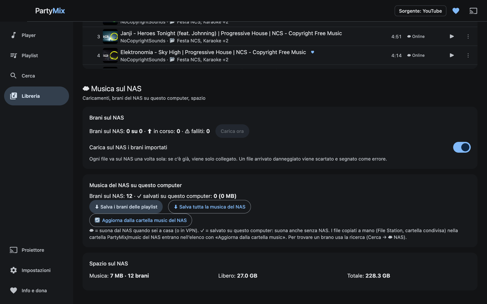

**Installare PartyMix sul NAS.** Una volta sola: segui la guida passo passo **[NAS.md](NAS.md)** (Synology anche senza Docker, QNAP, Unraid, TrueNAS, Linux). Poi da un browser della rete di casa l'indirizzo `http://IP-DEL-NAS:8788/api/health` deve rispondere `{"app":"partymix",…}`.

**Collegare un dispositivo** (⚙ Impostazioni → NAS e sincronizzazione):
1. Scrivi l'indirizzo del NAS (per esempio `192.168.1.10`: la porta 8788 si aggiunge da sola) e premi **Controlla**.
2. **Synology:** accedi con il **tuo utente del NAS**, cioè il nome e la password che usi per DSM. Ogni persona di casa entra con il suo; musica e playlist sono in comune. Gli amministratori del NAS possono anche togliere brani e gestire i dispositivi di tutti (dettagli in [NAS.md › Chi può entrare](NAS.md#chi-può-entrare)).
   **Altri NAS:** la prima volta crei l'account di PartyMix (nome e password), poi sugli altri dispositivi accedi con gli stessi dati.
   **Sempre:** puoi entrare anche con il **codice a 6 cifre** che trovi in **Dispositivi → + Aggiungi dispositivo** su un dispositivo già collegato (vale 5 minuti).
3. Su **Android 17** il telefono chiede il permesso **«Dispositivi nelle vicinanze / rete locale»**: rispondi **Consenti**, altrimenti l'app non vede il NAS. Se l'hai negato, PartyMix apre le impostazioni dell'app per cambiarlo.

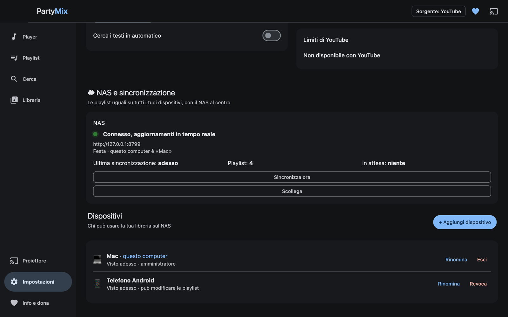 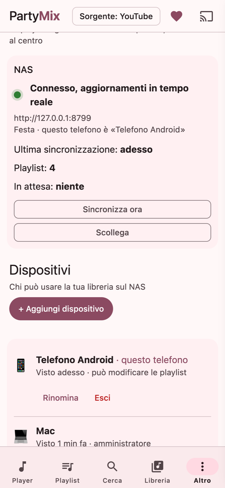

**Le playlist.** Ogni modifica (aggiungi, togli, sposta, rinomina) arriva sugli altri dispositivi da sola. Se lavori senza NAS, le modifiche aspettano e partono quando torna. Se due dispositivi cambiano la stessa cosa in modi diversi, PartyMix te lo chiede in Impostazioni → NAS («Usa questo computer» / «Usa il NAS»): niente viene perso in silenzio.

**La musica sul NAS** (🎧 Libreria, in fondo: «☁ Musica sul NAS»):
- **Carica ora** manda sul NAS i file della tua libreria (con «Carica sul NAS i brani importati» succede da solo). Ogni file va sul NAS una volta sola; un file arrivato danneggiato viene scartato.
- **Avanzamento dei file**: una riga per brano con la sua barra (⏳ in attesa, ⬆ caricamento con la percentuale, ✓ sul NAS, ⚠ non riuscito con il motivo e **Riprova**). Filtri: Tutti, In corso, Non riusciti.
- **🔄 Aggiorna dalla cartella music del NAS**: se copi dei file a mano nella cartella `PartyMix/music` del NAS (File Station, cartella condivisa), entrano nell'elenco. Titolo e artista vengono dal nome: «Artista/Album/03 Titolo.mp3» oppure «Artista - Titolo.mp3».
- **Spazio sul NAS**: quanta musica c'è e quanto spazio resta.

**Ascoltare dal NAS.** In **🔎 Cerca** scegli **☁ NAS** e scrivi titolo, artista o album: i risultati arrivano mentre scrivi. **▶** suona subito in streaming dal NAS (sul deck leggi «🗄 Dal NAS di casa»); **⋮** lo mette in coda, in una playlist o lo salva su questo dispositivo. I brani del NAS compaiono anche in Libreria con ☁.

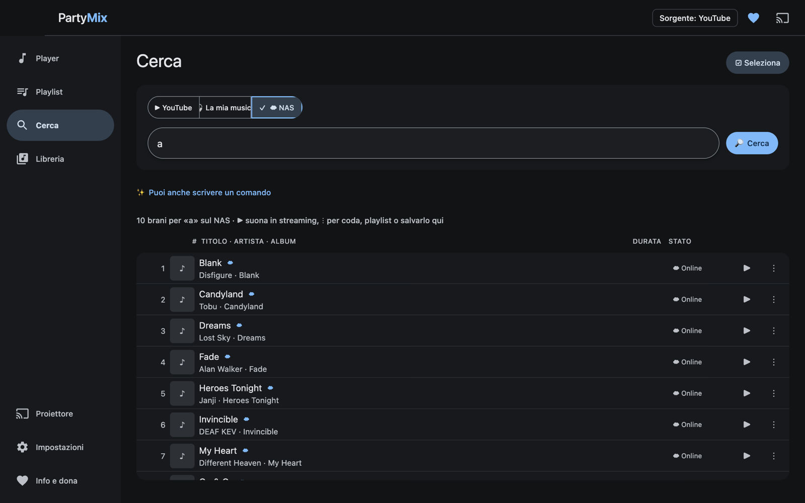

**Senza NAS (fuori casa, in aereo).** In Libreria → «Musica del NAS su questo dispositivo»:
- **⬇ Salva i brani delle playlist**: copia sul dispositivo i brani del NAS che stanno nelle tue playlist.
- **⬇ Salva tutta la musica del NAS**: copia tutto.

Prima di cominciare l'app controlla che ci sia spazio; copia due brani alla volta e mostra l'avanzamento. I brani salvati (✓) suonano anche senza NAS; «Elimina download» toglie solo la copia.

**Dispositivi.** In Impostazioni → Dispositivi vedi chi usa la tua libreria e quando si è visto l'ultima volta. Puoi rinominare un dispositivo o togliergli l'accesso (**Revoca**): da quel momento non può più leggere niente, nemmeno i link di ascolto già dati.

**Sicurezza.** Il server risponde solo dalla rete di casa (o da una VPN come Tailscale); non va aperta nessuna porta sul router. La password è salvata cifrata e ogni dispositivo ha una chiave sua, revocabile.

## 💜 Sostieni PartyMix

PartyMix è gratuito, senza pubblicità aggiunte e senza account, e lo sviluppo continua con le idee di chi lo usa. Se ti ha fatto ballare e cantare, puoi offrire un piccolo contributo, del tutto facoltativo. Aiuta a portare avanti nuove funzioni e aggiornamenti.

  Inquadra il codice con l'app PayPal, oppure <a href="https://www.paypal.com/qrcodes/p2pqrc/8AXGQ7233LRNL"><b>tocca qui dal telefono</b></a>. 
  Lo stesso codice è nella finestra <b>Info</b> dell'app.

Grazie! E buona festa 🎉

