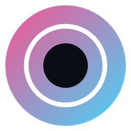
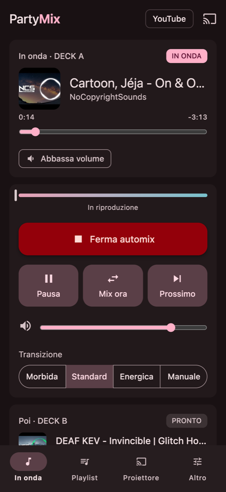
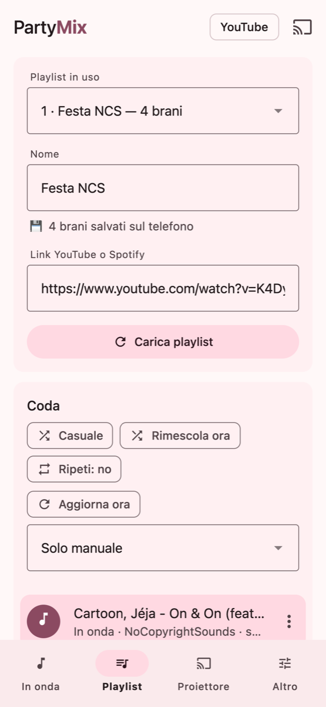
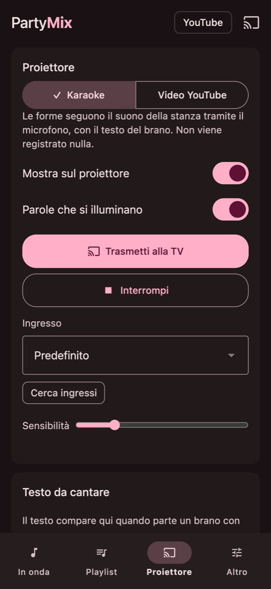
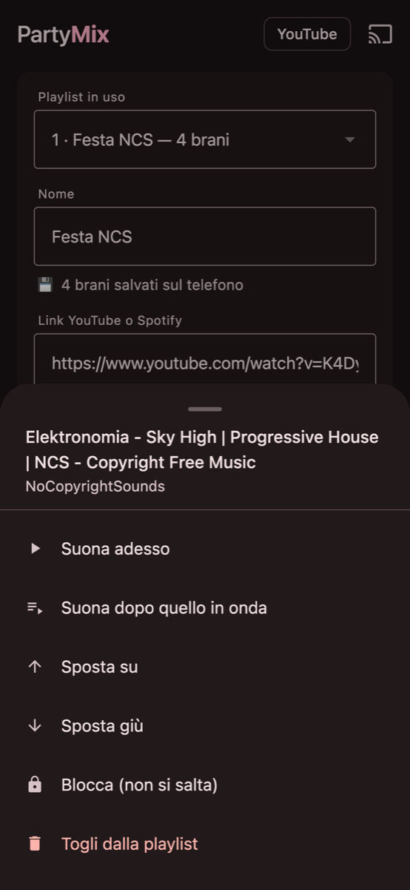
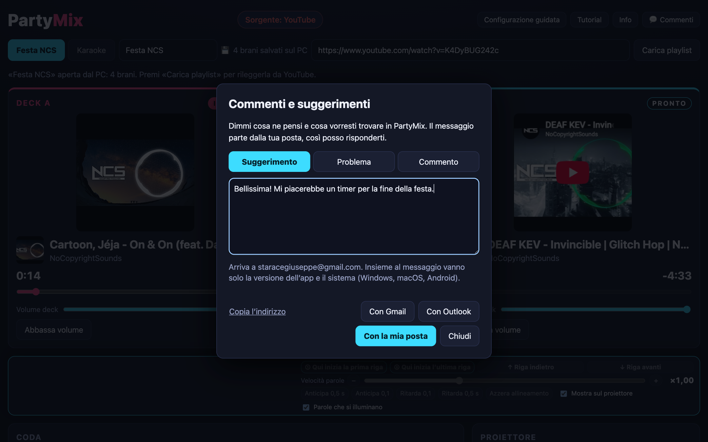

<h1 align="center">Guida di PartyMix</h1>

<b>Il DJ virtuale gratuito per le tue feste.</b> Incolli una playlist, premi un tasto e la musica va avanti da sola: sfumature tra i brani, karaoke e proiettore sulla TV.

  <a href="https://github.com/staracegiuseppe/partymix/releases/latest"><b>⬇️ Scarica PartyMix</b></a> ·
  <a href="https://staracegiuseppe.github.io/partymix/">🌐 Sito</a> ·
  <a href="#-sostieni-partymix">💜 Sostieni il progetto</a>

  
  
  

PartyMix suona una playlist YouTube o Spotify come farebbe un DJ: mentre un brano finisce, il successivo entra con una sfumatura. Puoi mandare su una TV o un proiettore le forme che ballano a tempo con il testo da cantare, oppure il video del brano.

Questa guida vale per 💻 **computer** (macOS e Windows) e 📱 **Android**. Dove cambia qualcosa, lo trovi indicato. Per scaricare e installare l'app leggi [INSTALLAZIONE.md](INSTALLAZIONE.md).

- [1. Primo avvio](#1-primo-avvio)
- [2. Dove si trova cosa](#2-dove-si-trova-cosa)
- [3. Le playlist](#3-le-playlist)
- [4. Far partire la musica](#4-far-partire-la-musica)
- [5. La coda dei brani](#5-la-coda-dei-brani)
- [6. Il proiettore](#6-il-proiettore)
- [7. Il testo da cantare](#7-il-testo-da-cantare)
- [8. Pubblicità e spot](#8-pubblicità-e-spot)
- [9. Commenti, aiuto e informazioni](#9-commenti-aiuto-e-informazioni)
- [10. Se qualcosa non va](#10-se-qualcosa-non-va)
- [💜 Sostieni PartyMix](#-sostieni-partymix)

## 1. Primo avvio

Al primo avvio si apre la **Configurazione guidata**, che ti fa fare tutto in ordine: caricare una playlist, aprire il proiettore, scegliere il microfono e lo stile delle transizioni. Puoi riaprirla quando vuoi:

- **Computer:** pulsante «Configurazione guidata» in alto.
- **Android:** sezione **Altro › Aiuto**.

Il **Tutorial** mostra una parte dell'app alla volta con una breve spiegazione. Su Android ti porta da solo nella sezione di cui parla.

## 2. Dove si trova cosa

### Computer

Tutto è in un'unica finestra:

- **In alto:** le playlist e il link.
- **Al centro:** i due deck (A e B), cioè i due giradischi virtuali, con in mezzo il mixer.
- **Barra bassa sempre visibile:** il testo da cantare.
- **Sotto:** la coda dei brani e i pannelli Proiettore, Pubblicità, Karaoke automatico, Testo, Già suonati, Stato e problemi.

### Android

L'app segue lo stile Material Design e ha quattro sezioni nella barra in basso:

<table>
<tr>
<td align="center"> <b>In onda</b></td>
<td align="center"> <b>Playlist</b> (tema chiaro)</td>
<td align="center"> <b>Proiettore</b></td>
</tr>
</table>

| Sezione | Cosa contiene |
|---|---|
| **In onda** | Il brano che si sente (copertina, titolo, tempo, barra per spostarsi), **Avvia/Ferma automix**, Pausa, Mix ora, Prossimo, volume e stile delle transizioni. Più sotto la scheda «Poi» con il brano già pronto |
| **Playlist** | Il menu delle quattro playlist, il nome, il link, «Carica playlist», «Scegli dalle app» e la coda dei brani |
| **Proiettore** | Karaoke o Video YouTube, «Trasmetti alla TV», microfono e la scheda «Testo da cantare» per mettere il testo a tempo |
| **Altro** | Karaoke automatico, brani brevi (spot), aiuto, commenti, informazioni, brani già suonati e problemi |

- L'icona **Trasmetti** in alto a destra apre subito il proiettore sulla TV.
- Il tasto **Indietro** chiude un pannello aperto, poi torna a «In onda». Da «In onda» manda l'app in secondo piano senza chiuderla, quindi la musica continua.
- I messaggi dell'app compaiono in basso per qualche secondo; toccali per farli sparire.
- I **colori seguono il tuo telefono**: tema chiaro o scuro come l'hai impostato. Da Android 12 l'app usa anche i colori Material You presi dallo sfondo.

## 3. Le playlist

Puoi tenere **quattro playlist** e scegliere quella da suonare dal **menu a tendina**. Per ogni playlist il menu mostra il nome e quanti brani ha salvato, oppure «vuota».

**Aggiungere una playlist**

1. Scegli nel menu una playlist vuota.
2. Dalle un nome, per esempio «Festa», «Karaoke» o «Just Dance».
3. Incolla il link di una playlist YouTube, oppure di una playlist o di un album Spotify pubblici, e premi **Carica playlist**.

Su Android c'è un modo più comodo: **Scegli dalle app**.
1. Apri la playlist in YouTube o in Spotify.
2. Tocca **Condividi › PartyMix**: la playlist si carica da sola.

**Salvataggio.** I brani restano salvati sul computer o sul telefono.
- Quando torni a quella playlist si apre subito, senza aspettare YouTube.
- I brani che togli restano tolti e l'ordine che scegli resta com'è.
- **Carica playlist** rilegge invece la playlist da YouTube o Spotify da capo.

**Aggiornamento.** Se aggiungi brani alla playlist su YouTube, PartyMix li può prendere da solo: nella coda scegli ogni quanti minuti controllare, oppure premi «Aggiorna ora». Una playlist Spotify viene letta una volta sola.

Con Spotify l'app prende solo l'elenco dei brani e li suona da YouTube, perché Spotify non si può suonare dentro altre app. Qualche brano può non trovarsi: l'app ti dice quali.

## 4. Far partire la musica

Premi **Avvia automix**. Parte il primo brano e da lì l'app va avanti da sola: un deck suona e l'altro prepara il brano dopo, così non c'è mai silenzio.

| Comando | Cosa fa |
|---|---|
| **Pausa / Riprendi** | Ferma e fa ripartire tutto |
| **Mix ora** (computer: «Transizione immediata») | Sfuma subito nel brano già pronto |
| **Prossimo** | Salta al brano successivo, con una sfumatura |
| **Volume** | Volume di tutta la festa |
| **Transizione** | Morbida (circa 12 secondi), Standard (8), Energica (4) o Manuale (il cambio avviene solo quando lo chiedi tu) |
| **Abbassa volume** | Abbassa al volo il brano in onda, per esempio durante un annuncio; si ripremi per tornare normale |

Sul computer funzionano anche i tasti rapidi:
- Spazio: pausa.
- → (freccia destra): prossimo.
- M: mix ora.
- S: ferma l'automix.
- ↑ e ↓ (frecce su e giù): volume.

## 5. La coda dei brani

**Computer.** Ogni riga ha i tasti Su, Giù, Blocca e «✕ Togli».
- «✕ Togli» chiede «Sicuro?»: premilo una seconda volta entro 3 secondi per confermare.
- Con un doppio clic suoni subito un brano.
- Trascinando le righe cambi l'ordine.

**Android.** Tocca un brano e si apre un pannello dal basso con:

- **Suona adesso**
- **Suona dopo quello in onda**
- **Sposta su** / **Sposta giù**
- **Blocca**: un brano bloccato non viene saltato con «Prossimo».
- **Togli dalla playlist**

**Comandi comuni**
- **Casuale**, **Rimescola ora** e **Ripeti** (no, tutta la playlist, solo questo brano).
- Puoi aggiungere un singolo video incollando il suo link.
- Il brano in onda non si può togliere: passa al successivo e poi toglilo.
- Se un brano non si può riprodurre, compare un avviso. Lì incolli il link di un brano sostitutivo e l'app ti dice subito se va bene.

## 6. Il proiettore

Il proiettore è una seconda schermata, da mandare su TV o videoproiettore, che mostra una di due cose:

- **Karaoke:** forme colorate che seguono il suono della stanza attraverso il microfono, con il testo da cantare. Il suono non viene registrato.
- **Video YouTube:** il video del brano in onda a tutto schermo, muto e allineato alla musica. È perfetto per i balli tipo Just Dance. Il video successivo è già caricato, quindi al cambio brano lo schermo non diventa mai nero. Quando YouTube mostra una pubblicità, al suo posto restano le forme.

**Computer.** Premi **Apri proiettore** e scegli lo schermo: secondo monitor, TV collegata o proiettore. Nel pannello scegli anche il microfono e la sensibilità.

**Android.** Premi **Trasmetti alla TV** (oppure l'icona in alto).
1. Si aprono le impostazioni di Android «Trasmetti» o «Schermo wireless».
2. Scegli la TV o il proiettore.
3. Torna in PartyMix: il proiettore compare sulla TV da solo e il telefono resta la console.

Funziona con i dispositivi che ricevono uno «schermo wireless» (Miracast; su molti Android TV con un'app ricevitore) o collegati via cavo. Un Chromecast che copia soltanto lo schermo del telefono mostrerebbe la console invece del proiettore.

## 7. Il testo da cantare

Quando carichi una playlist, in sottofondo PartyMix cerca i testi di tutti i brani, così sono pronti quando partono. Nella coda ogni brano ha un'etichetta:

| Etichetta | Significato |
|---|---|
| **testo a tempo** | Il testo ha i tempi esatti |
| **testo stimato** | Il testo è stato trovato, ma i tempi sono calcolati sulla durata |
| **senza testo** | Il testo non è stato trovato |

Se il testo non è a tempo con il video:

- Premi **① Qui inizia la prima riga** quando il cantante attacca la prima riga, e **② Qui inizia l'ultima riga** all'ultima: in due tocchi il testo si allinea, e l'allineamento resta salvato per quel video.
- **Riga indietro / Riga avanti** spostano il testo di una riga.
- **Anticipa / Ritarda** lo spostano di qualche decimo di secondo.
- **Velocità parole** regola il ritmo.
- Nell'elenco del pannello Testo puoi anche toccare la riga che si sta cantando in quel momento.

Dove trovarli:
- **Computer:** nella barra bassa.
- **Android:** in **Proiettore › Testo da cantare**.

Interruttori:
- **Mostra sul proiettore** mostra o nasconde il testo sul proiettore.
- **Parole che si illuminano** colora le parole mentre vengono cantate. Spegnilo se le parole colorate non sono a tempo e ti danno fastidio: la riga resta tutta bianca.

## 8. Pubblicità e spot

- **Brani brevi (spot)**, su computer e Android.
  - Gli spot inseriti nelle playlist durano pochi secondi, le canzoni minuti.
  - Per i brani sotto i 75 secondi puoi scegliere «Abbassa il volume» o «Salta al brano dopo».
- **Abbassa il volume durante le pubblicità**, solo su computer.
  - PartyMix ascolta l'audio che sta suonando: se sente una voce che parla, come in uno spot, abbassa il volume e lo rialza quando torna la musica.
  - Su macOS la prima volta il Mac chiede il permesso di registrare l'audio di sistema.
  - L'audio non viene registrato né salvato.

Le pubblicità che YouTube inserisce nel suo player non si possono saltare né nascondere.

## 9. Commenti, aiuto e informazioni

- **💬 Commenti** (computer: in alto; Android: Altro › Aiuto).
  1. Scegli se è un suggerimento, un problema o un commento.
  2. Scrivi il messaggio.
  3. Il messaggio si apre già pronto nella tua posta, in Gmail o in Outlook e lo invii tu, dal tuo account.
- **Info** mostra la versione e l'autore. C'è anche una donazione PayPal facoltativa per chi vuole ringraziare.

## 10. Se qualcosa non va

- **La playlist non si carica:** controlla che sia pubblica (o non in elenco) e che la rete funzioni.
- **Un brano viene saltato:** il proprietario non permette di suonarlo fuori da YouTube. Lo trovi in «Stato e problemi»; sostituiscilo dall'avviso dei brani non riproducibili.
- **Il testo è sfasato:** usa ① e ② (vedi il [capitolo 7](#7-il-testo-da-cantare)), oppure spegni «Parole che si illuminano».
- **Android: sulla TV vedo il telefono invece del proiettore:** il dispositivo copia lo schermo ma non riceve uno «schermo wireless». Prova un'app ricevitore Miracast sulla TV, oppure un cavo HDMI.
- **Android: la musica si ferma con lo schermo spento.** PartyMix tiene viva la musica con la notifica «La festa continua anche a schermo spento». Se il telefono la ferma lo stesso, togli PartyMix dall'ottimizzazione della batteria nelle impostazioni di Android.
- Per tutto il resto scrivimi da **💬 Commenti**.

## 💜 Sostieni PartyMix

PartyMix è gratuito, senza pubblicità aggiunte e senza account, e lo sviluppo continua con le idee di chi lo usa. Se ti ha fatto ballare e cantare, puoi offrire un piccolo contributo, del tutto facoltativo. Aiuta a portare avanti nuove funzioni e aggiornamenti.

  Inquadra il codice con l'app PayPal, oppure <a href="https://www.paypal.com/qrcodes/p2pqrc/8AXGQ7233LRNL"><b>tocca qui dal telefono</b></a>. 
  Lo stesso codice è nella finestra <b>Info</b> dell'app.

Grazie! E buona festa 🎉

